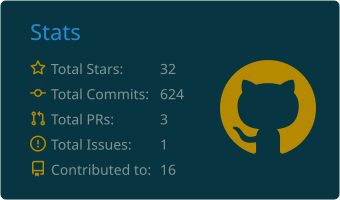
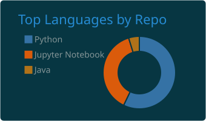
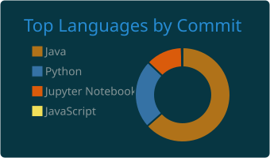

<!-- ============================== HEADER ============================== -->
<div align="center">


<a href="https://github.com/Arshp-svg">
  
</a>

<br/>


<br/><br/>

<a href="https://www.linkedin.com/in/arsh-patel-bb23502bb"></a>
<a href="mailto:arshpatel213@gmail.com"></a>
<a href="https://leetcode.com/u/Arsh_014/"></a>
<a href="https://github.com/Arshp-svg"></a>

</div>

---

## 👋 About Me

I'm a **Generative AI Engineer** (B.Tech CSE, class of 2027) who builds **LLM-powered applications, RAG systems, and multi-agent workflows**. I care about the parts that make AI dependable: grounding, evaluation, guardrails, tracing, and tool integration, from evidence-grounded RAG and incident investigation to fine-tuned models and orchestrated agent teams.

```python
class ArshPatel:
    role     = "Generative AI Engineer"
    focus    = ["LLM applications", "RAG systems", "Multi-agent workflows", "Fine-tuning (LoRA / PEFT)"]
    approach = "Build → Evaluate → Observe → Improve → Explain the evidence"
    values   = ["Reliability", "Observability", "Measurable results"]

    def currently_exploring(self):
        return [
            "Reliable & observable agentic systems",
            "Evaluation-driven RAG and retrieval quality",
            "Context engineering and tool integration for agents",
            "Secure AI infrastructure & human-in-the-loop workflows",
        ]
```

<table>
<tr>
<td width="50%" valign="top">

### 🎯 What I Build
- 🧠 **Grounded RAG systems** that retrieve, rerank, cite evidence, and abstain when confidence is low
- 🤖 **Multi-agent workflows** with orchestration, state tracking, and deterministic guardrails
- 🔧 **Fine-tuned LLMs** using LoRA, PEFT, and 4-bit quantization
- ⚙️ **Production backends** with FastAPI, vector databases, tracing, and cost monitoring

</td>
<td width="50%" valign="top">

### 🔭 Currently Exploring
- 🔍 Evaluation-driven RAG and retrieval quality
- 🛰️ Reliable and observable agentic systems
- 🧩 Context engineering and tool integration for agents
- 🔐 Secure AI infrastructure and human-in-the-loop workflows

</td>
</tr>
</table>

---

## 🚀 Featured Projects

<table>
<tr>
<td width="50%" valign="top">

### 🧠 [AI Knowledge OS](https://github.com/Arshp-svg/AI-Knowledge-OS)
**Production-grade RAG platform**

Hybrid retrieval (dense + BM25 with Reciprocal Rank Fusion), FlashRank neural reranking, prompt-injection and PII guardrails, a grounding gate that skips the LLM call when evidence is weak, and tracing with Langfuse and OpenTelemetry. Container RAM cut by 75% using FastEmbed (ONNX).

**📈 Evaluated on a 15-question golden set (Ragas):**
`100%` faithfulness · `90.7%` answer relevance · `88%` context precision · `815 ms` mean latency


[🌐 Live Demo](https://ai-knowledge-os-kappa.vercel.app/) · [📂 Repo](https://github.com/Arshp-svg/AI-Knowledge-OS)

</td>
<td width="50%" valign="top">

### 🚨 [IncidentIQ](https://github.com/Arshp-svg/incidentiq)
**Evidence-grounded AI incident investigation**

Event-driven pipeline that correlates telemetry, retrieves runbooks, traverses service dependencies through MCP, and produces schema-validated reports. A deterministic validator rejects any citation that isn't in the data, and the agent abstains when evidence is inconclusive.

**📈 Evaluated on 40 labeled incidents:**
`100%` root-cause accuracy · `100%` evidence validity · `96.9%` Recall@3 · `~80 ms` p50


[🌐 Live Demo](https://incidentiq-khaki.vercel.app) · [📂 Repo](https://github.com/Arshp-svg/incidentiq)

</td>
</tr>
<tr>
<td width="50%" valign="top">

### 🕸️ [Hierarchical Multi-Agent System](https://github.com/Arshp-svg/hierarchical-agent-system)
**LLM orchestration with LangGraph**

An 8-node, 3-tier agent workflow (1 CEO orchestrator, 2 team leaders, 4 specialists) with a 4-stage pipeline covering planning, research, writing, and consolidation, plus centralized state tracking. Ships with a CLI and a Streamlit UI with configurable LLM providers and real-time agent-message tracking.


[📂 Repo](https://github.com/Arshp-svg/hierarchical-agent-system)

</td>
<td width="50%" valign="top">

### 🐳 Dockerfile Explainer
**Fine-tuned LLaMA for generative explanations**

Fine-tuned a 3.5B-parameter LLaMA model with LoRA and PEFT (8.39M trainable parameters) to generate multi-stage Dockerfile explanations.

**📈 Results:**
Peak VRAM `12.57 GB → 3.96 GB` (68.5% lower) with 4-bit quantization · `19.33 s` average inference latency


</td>
</tr>
<tr>
<td width="50%" valign="top">

### 💸 [RazorGrow](https://github.com/Arshp-svg/RazorGrow)
**Autonomous revenue workflows**

Agentic commerce workflows with policy enforcement, human approval gates, and idempotent payments, so high-risk actions stay under deterministic control.

[📂 Repo](https://github.com/Arshp-svg/RazorGrow)

</td>
<td width="50%" valign="top">

### ✂️ [Shortify](https://github.com/Arshp-svg/Shortify)
**Backend performance lab**

Hypothesis-driven backend engineering, with every change measured under load.

**📈 Measured results:**
`405×` faster lookups with a B-tree index · `432 → 908 RPS` with Redis cache-aside · `96.4%` cache hit ratio · `71/71` tests passing


[📂 Repo](https://github.com/Arshp-svg/Shortify)

</td>
</tr>
</table>

<details>
<summary><b>🧪 More projects (agents, NLP & ML)</b></summary>
<br/>

| Project | Focus |
| :-- | :-- |
| [**supervisor_agent_app**](https://github.com/Arshp-svg/supervisor_agent_app) | Supervisor-pattern agent app (Jupyter Notebook) |
| [**AutoOps**](https://github.com/Arshp-svg/AutoOps) | Python automation and operations project |
| [**Text-Summarization**](https://github.com/Arshp-svg/Text-Summarization) | NLP text summarization (Jupyter Notebook) |
| [**Student_Performance_Prediction**](https://github.com/Arshp-svg/Student_Performance_Prediction) | Machine learning prediction project (Jupyter Notebook) |

</details>

---

## 🛠️ Tech Stack

<div align="center">

**Languages**


**GenAI & LLMs**


`RAG` · `Prompt engineering` · `LangChain` · `LangGraph` · `Groq LLM APIs` · `Llama 3` · `LoRA / PEFT` · `Transformers` · `MCP`

**Retrieval**

`FAISS` · `Qdrant` · `pgvector` · `SentenceTransformers` · `Embeddings` · `Semantic chunking` · `BM25` · `PDF parsing`

**Backend & Databases**


**Frontend & DevOps**


</div>

---

## 🏆 Highlights

| | |
| :-- | :-- |
| 🧑‍💻 **Machine Learning Intern**, RacksonsIT Solutions (Jun to Jul 2025) | Built a CNN traffic sign classifier reaching 98% accuracy, up from 93% through preprocessing, augmentation, and tuning |
| 🚌 **PATH**, Public Transportation Assistance Hub | Rural transportation accessibility solution under IIT Bombay mentorship; e-Yantra semi-finalist among 400 teams |
| 📜 **CelestiQ**, co-author of a published design patent | Core backend and DBMS architecture across 6 modules (resume parsing, aptitude tests, AI interviews, HR analytics, and more) |

---

## 📊 GitHub Stats

<div align="center">

<!-- Cards below are generated into this repo by .github/workflows/profile-summary.yml -->




<br/>


<br/>

<!-- Snake animation: requires the workflow in .github/workflows/snake.yml -->
<picture>
  <source media="(prefers-color-scheme: dark)" srcset="https://raw.githubusercontent.com/Arshp-svg/Arshp-svg/output/github-snake-dark.svg" />
  <source media="(prefers-color-scheme: light)" srcset="https://raw.githubusercontent.com/Arshp-svg/Arshp-svg/output/github-snake.svg" />
  
</picture>

</div>

---

## 🤝 Let's Connect

I'm open to collaborating on **LLM applications, agentic systems, RAG, and open-source AI tooling**.

<div align="center">

<a href="https://www.linkedin.com/in/arsh-patel-bb23502bb"></a>
<a href="mailto:arshpatel213@gmail.com"></a>

<br/><br/>


</div>
